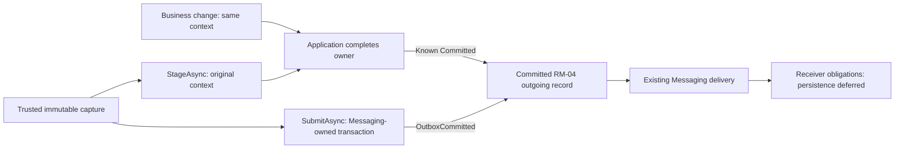

# RM-06 bounded implementation plan

Status: approved by the user on 23 November 2026. Native execution follows
eligible task activation and the shared allocation. Previous owners remain closed.

## Requirements and actual baseline

- Source: [RM-06 v1.0](../../../planning/audit/sources/CISLIB_RM06_Audit_Contracts_and_Delivery_Integration_Specification.md), 23 November 2026.
- Exact source SHA256: `1dba943444b4228d086d765152aff61c2197d9a0cb422dbe4c607394cad2a402`.
- Source's inspected revision: `eee73d581460a2e20fd406d526b7303070f0bc25`.
- Actual implementation baseline: `dcb61dc13c8af138f409db4e13c477cc3a06a0b5`, including merged RM-05 and its jobs/Visual Studio corrections.
- Branch: `codex/rm06-audit-contracts`; native CIS change: `CIS-0023`.

The attached document supplies requirements, including its implementation-agent
section. Current user/session authority and repository execution controls govern
actions. The user approved P01–P16 and the proposed shared allocation in one
decision. The existing untracked CountryData launch settings remain
user-owned and unchanged.

## Deliverable and boundary

Deliver one versioned portable Audit envelope, immutable trusted capture, public
transactional/standalone writer, explicit compatible Security adapter, and the
existing Messaging delivery/receiving integration. Keep new module types in
`CIS.Audit` within Core and registration in `CIS.Audit.Hosting`. Keep one consumer
guide, small conformance fixtures, public CommonTesting substitution and concise
agent guidance.

There is no Audit destination database, table/migration/index, repository/store
API, archive/query/retention/export/portal, collector, receipt service, second
inbox/outbox, retry scheduler, spool or idempotency coordinator. Existing outgoing
Messaging storage remains its existing responsibility. Contract append-only
behavior supplies no compliance or archival-durability claim.

NotCommitted and Unknown retain their distinct facts; neither follows the known
commit arrows or proves a receiver/archive result.

## Reconciled profile P01–P16

| ID | Proposed contract/implementation choice |
| --- | --- |
| P01 | Preserve the exact source and actual merged baseline. Reuse current RM-01/02/03/04/05 APIs; no new NuGet, source mapping, runtime/SDK pin, project or shipping dependency. |
| P02 | Common envelope `auditVersion=1`; stable Messaging `cis.audit.record`, schema1, Event. Register one application-selected bounded route before Messaging's graph freezes; select production delivery only against its actual matching store/route/runtime. |
| P03 | Strict complete UTF-8 JSON object: closed common fields, duplicate rejection at every depth, valid Unicode and bounded required values. Canonical capture emits UTC timestamps with seven fractional digits; generic decode/forward retains exact original bytes and opaque unknown application details. Explicit detail codecs/schema mappings; decimal/large-identifier strings, no arbitrary object serialization. |
| P04 | Public portable `AuditRecord` stays separate from source-eligible `CapturedAuditRecord`. Only trusted local capture/adapter creates the latter; no decoded-record promotion. Capture snapshots ID/time/context/details once and exposes only immutable data or defensive byte copies. |
| P05 | Scoped ordinary capture reads actual trusted caller; missing caller is unknown, anonymous requires actual anonymous projection, and explicit local system work is separate. Preserve issuer/human/delegation and Reported/Verified distinctions. Local process instance remains Reported. Retain native scalar bounds and full256hook capabilities; omit only optional outer correlation if it cannot fit RM-04's128UTF-8-byte limit, while keeping full valid Audit data. |
| P06 | Default complete Audit body256KiB/depth16; positive configured limits through1MiB/depth32 also fit actual Messaging payload/depth limits. Preserve its separate16KiB metadata allowance/validation. Use existing internal MessagingResourceBudget nonblocking admission before extra library-owned encoding copies; no public admission API/new budget/automatic limit increase. Retained application-owned captures are not a global heap bound. |
| P07 | Stage through public IMessageOutbox.PublishAsync on the original active, non-poisoned configured ReadCommitted context. Audit-side pre-Messaging validation/admission/encoding refusal or fault poisons a usable context without replacing an original exception. Never retain/complete/dispose its owner. A capture failure before Stage requires the application's explicit poison/abandon path. |
| P08 | Submit through public IMessagingClient.PublishAsync. Preserve NotSubmitted, OutboxCommitted and Unknown, exact available receipt, actual TransactionCompletion and cleanup facts. An impossible NotConfirmed from an inconsistent substitute is a fault, not invented noncommit. No automatic Unknown retry or receiver/archive success label. |
| P09 | Reusing one captured AuditId in two deliberate calls creates two Messaging envelopes; transport retries retain their original message and exact bytes. Same-AuditId/same-original-payload and conflicting-payload obligations belong to the future durable receiver; publish independent vectors, not a persistence implementation. |
| P10 | Explicit singleton-safe Security bridge maps immutable hook facts into `cis.security.authorization.decision` v1 and `cis.security.operation.reported` v1. Register before AddCisSecurity and reject ambiguous real-sink replacement. Preserve complete final decision, full capabilities, Unicode-safe outcome codes and post-effect reported outcome/capture gap; no inferred commit. |
| P11 | Suppress only recursive automatic authorization observation for a dedicated trusted configured Audit ingress target and exact complete ingress/retry capability sets. Target resolution closes over configuration, never payload/header flags. Actual auth/authorization/denial continues. Current RM-04 authentication failure emits no audit hook; ordinary HTTP missing-caller/target observations remain auditable. Receiving validation binds Audit producer to the authenticated MessageHandlerContext.Envelope producer, with RetryValidator checking retained original MessageProvenance. Do not compare a retried payload to its current local retry caller or invent a forwarding protocol. |
| P12 | Bridge timeout defaults5seconds, positive through60seconds; earlier caller cancellation wins. It covers capture/admission/new-owner/SQL waits and requests cancellation while joining actual provider/transaction cleanup. A late established commit stays committed; refusal/Unknown is a safe result-rich bridge failure. No arbitrary callback detach or global capacity inflation. |
| P13 | Passive definition/DI registration, no database/topology/worker constructor I/O. Audit owns only its added capture/publication admission and actual drain. Join it before Messaging disposal; preserve RM-05 final audit calls during job drain, sequential startup, known host order and facade failed-Build cleanup. Change only necessary existing cooperating host paths; no new lifecycle/DI framework. |
| P14 | Reuse Messaging delivery backlog/age/failure health and metrics. Add at most one conditional `audit.capture.results` counter with category business/administration/security and outcome captured/rejected/faulted, using central identity. Safe quiet diagnostics have finite persistent budgets; no payload, subject, AuditId, resource, correlation or event-detail labels/history. Telemetry cannot change an established result. |
| P15 | Reuse ordinary MSTest, existing schema evaluator subset, owned PostgreSQL/RabbitMQ fixtures and outside-friend public-package helper. Permit only a small minItems/maxItems extension in the existing schema evaluator so security detail schemas express the full256capability bound; no validator package/engine. One opt-in CountryData producer and test-only receiver example retain the database-free default. Windows real services and actual Ubuntu managed units are selected; any unexecuted Linux-client service claim remains explicit. No new fixture project/process mode or broad Messaging/mutation/performance campaign. |
| P16 | One shared24hours/28logical attempts includes2700protected restoration seconds, all agents/intake/builds/tests/docs/review. Keep existing physical6GiB ceiling,64MiB reserve,2GiB counted Docker allowance and retained cache charges. Max4owned containers including Ryuk; preserve foreign resources and user inputs. No existing database access, external deployment, push, merge or release. |

## Four main implementation tasks and portable contract support

The JSON definitions in [proposed-tasks.json](proposed-tasks.json) now have native
contracts under the recorded authority. Supporting tests/docs/review stay with
their implementation task; they are not standalone campaigns.

| Task | Outcome and acceptance | Depends on | Shared distribution |
| --- | --- | --- | --- |
| WORK-001 | Portable v1/schema/independent vectors, strict codec, trusted source/capture boundary, memory admission and bounded ScriptedAuditWriter. AC01–03 and public AC12; freeze public interfaces and lifecycle handshake. | None | 6h /6attempts /600s restoration |
| WORK-002 | Original-context writer, actual standalone results, passive route/native/facade integration, admission/drain and conditional observations. Logical AC05–06/12 plus existing host compatibility. | WORK-001 | 7h /8attempts /900s restoration |
| WORK-003 | Two Security event schemas, explicit bridge, immutable trusted mapping, safe failures/deadline and narrow no-loop authorization handling. Logical AC09–11 and sink compatibility. | WORK-001 | 4.5h /4attempts /600s restoration |
| WORK-004 | Integrated PostgreSQL/RabbitMQ/Operations/nested Messaging/public-package and opt-in example proof; one guide, receiver obligations and skill/routing. Native AC04–08/11–12, final cross-review and truthful limits. | WORK-002/003 | 6h /8attempts /600s restoration |
| WORK-005 | Finish the portable Security detail boundary against independent vectors and the existing schema evaluator; include schema/runtime mapping review and documented proof. | WORK-003 | 0.5h /2attempts /0s restoration |

The controller added WORK-005 as small support for the Security component because
CIS preserves an already-started task's executable scope. Its existing
Architecture test file was already authorized in `capture-contracts`; two attempted
updates of WORK-003 were held without changing its contract. The supporting task
uses 30 minutes and two attempts redistributed from WORK-003. This introduces no
new outcome, package, evaluator, test campaign or shared capacity. The original
four principal implementation components and all spent costs remain intact.

After core completion, the controller moved one verified unused hour and two
attempts from WORK-001 to WORK-004. WORK-001 retains its measured/conservative
spent costs, 600 protected restoration seconds and more than 50 minutes of
ordinary headroom. Shared totals remain 24 hours/28 attempts/2,700 restoration
seconds. WORK-004's still-draft scope was also reconciled to the existing approved
Audit/cooperating-host scopes for corrections demonstrated by its required
integrated acceptance, without reopening completed owners or creating a redesign.

P14's logical `audit.capture.results` uses the canonical qualified
`cis.audit.capture.results` name required by the existing CIS module catalog.
Its only dimensions remain category and outcome, with nine possible combinations.

After WORK-001 freezes shared public APIs, WORK-002 and WORK-003 may proceed in
parallel under disjoint source ownership. Native builds/tests and shared project
files have one root writer. Runtime startup itself stays sequential. Task4 may
prepare independent test source while runtimes are written, but executes against
the completed current candidate. Redistribute only inside the containing totals.

## Focused verification

- Wire/schema/capture: independent valid and negative vectors, unknown details,
  exact forwarding, decimal precision, byte/depth/Unicode boundaries, escaped
  duplicate keys, actor/instance/delegation distinctions and mutable-input safety.
- Original transaction: use existing PostgresMessageFixture for business/outbox
  commit, rollback and unfinished-owner disposal. Ignore a pre-Messaging Audit
  refusal and still prove attempted commit cannot publish the business change.
- Submission/delivery: preserve three real completion states and exact receipts;
  reconstruct the source runtime over the same existing store, deliver through
  actual RabbitMQ route/codec, and retain IDs/bytes on transport retry. Separate
  two deliberate submissions from future AuditId persistence obligations.
- Security: full256capabilities, failed authentication/missing facts, complete
  decision and reported-operation mapping; refusal/Unknown/original exception and
  late commit. Exercise successive ingress deliveries, real nested Messaging
  memory pressure and direct Operations with a retained required connection,
  without increasing limits. Keep denial and committed administration unchanged.
- Host/public consumer: passive registration, wrong/missing runtime/route refusal,
  actual shutdown and failed-Build settlement with uncooperative owned work,
  optional counter export, public Core/CommonTesting compile and database-free
  example default. Existing compatibility/dependency checks are impact-focused.
- Actual Windows source/service and existing Ubuntu managed-runtime lanes; strict
  selected-service runsettings and report guard, zero selected skips. Preserve
  exact newly owned cleanup, compact TRX/log/hash receipts and every failed cost.

No current Audit tests have been run. Existing foundation results are reuse inputs,
not Audit acceptance. The main service workflow passed159cases at RM-05 closeout;
it is not a substitute for the new Audit checks.

## Authority and resource boundary

[Approved authorization](approved-authorization.json) and
[current allocation](current-integration-allocation.json) specify one
shared outcome and the current distributions. All already-performed source intake and measured CIS metadata
costs are included. The71-minute conservative source-intake checkpoint covers
root35minutes plus two independent18-minute reviews; later preparation remains
in the same ledger. Initial storage remains near the preceding5.41GiB checkpoint;
check actual growth before native admission and retain the64MiB reserve.

Native work needs a fresh eligible owner/allocation. Current [repository
guidance](../../../AGENTS.md) says: "Native execution requires a legitimate
approved work owner with remaining finite time/storage allocation; setup profiles
do not grant execution authority." Earlier completed owners remain closed. This
is the existing repository resource requirement, not an approval stage added by
the attached specification. Approval of this single proposed outcome/profile and
allocation delegates routine task organization and distribution within its limits.
