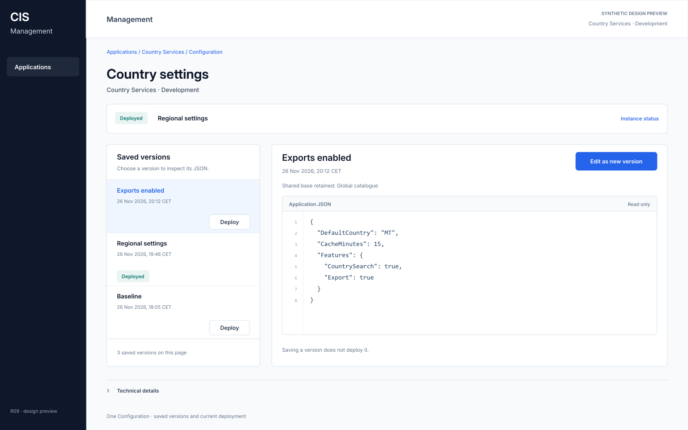

# R09 — Configuration versions and Deploy

**Approved synthetic screenshot package; implementation verification is pending.**
This is the screenshot checkpoint requested by Andrew. The request is one
Configuration page with saved versions, a clear Deployed version and deployment
of any retained version for rollback. Earlier R07/R08 approvals and all native
execution evidence remain unchanged; the earlier unapproved Save/Apply proposal
is superseded.

| Preview | Intended interaction |
| --- | --- |
| [Version list and selected JSON](assets/r09-configuration-versions.png) | Select a saved version to inspect its JSON. The actual deployed version stays clearly marked. Deploy is available on an older or newer saved version. |
| [Edit and Save version](assets/r09-configuration-edit-save.png) | Edit a copy on the same page, add a note and choose Save version. No publication/release wizard or separate Save confirmation. Saving does not deploy. |
| [Deploy an older version](assets/r09-configuration-deploy-older.png) | One confirmation names the selected saved version, current version and all-instance application/environment target. This is also rollback. |
| [Narrower desktop](assets/r09-configuration-versions-900.png) | The same version list and JSON stack within a 900px desktop window. This proposes the layout; actual browser geometry remains an implementation check. |

All versions use saved change notes and dates, with exact immutable identities
behind the controls. No guessed sequential version numbers or human authors are
introduced. Technical references are collapsed. Instance status expands on this
page; no separate canary/release/assignment screen is required for normal work.

A saved deployable version retains the exact Shared/Application pair. Save may
use existing setup/publication/release operations internally, with distinct
originals and truthful same-page partial/recovery. Deploy is a separate explicit
whole-map operation. It changes the selected Configuration's desired deployment
for all instances in its actual application/environment/schema binding. Existing
targeting, when actually present, must be disclosed before replacing it; the four
normal preview frames intentionally show no existing targeting. Recipient
acceptance remains independently observed and is not promised instantly.

The [technical contract](ux-r09-version-deployment.md) and
[bounded plan](ux-r09-version-plan.md) retain these limits. The canonical
wireframe/design supplements classify this as backoffice. WORK-189 owns design;
WORK-190 implements the approved workflow, with WORK-191 supporting the later
deployed-baseline comparison clarification. Their current focused build/browser
acceptance is recorded in [implementation verification](r09-implementation-verification.md);
screenshot approval itself is not a functional pass.

The exact [manifest](r09-preview-manifest.json) records all four PNG hashes,
dimensions and inputs:

- Renderer SHA-256: `6cbd590b6fb51e023da7f5b53dba27c822b84c770df9bb08b36d1f2fd3aaf306`.
- Proposal SHA-256: `ca797fdebd8156beb7b24a1af9aba3574b72347be4aa6f99cabc105fba86cc59`.
- Manifest SHA-256: `e8833e1d6d84a8e584aa00b44f475e5dba861e806cceb597d9ce06e98a9031ae`.

Three retained local render invocations used the existing pinned Node/Sharp
runtime under WORK-189. The initial render was refined to remove redundant
badges/technical copy, then one footer was corrected within the second bounded
design review attempt to avoid a false multi-stage persistence claim. Each
invocation verified dimensions/nonblank output and actual temporary-font cleanup.
Earlier unapproved frame hashes remain in the local first/second-pass records.
Root and an independent reviewer visually inspected all four final images.
No required visual/contract finding remains. The independent record is
`.cis/local/testing/rm09-completion/work189-r09-independent-review.md`, SHA-256
`b21e2645133471b673ecbaeac544cb3473c7800cf153dc104c0c52f909031d53`.
It records exact candidate hashes and the synthetic, zero-targeting and pending
functional-proof limits. The exact [user decision](r09-user-approval.json) records
Andrew's reply: “much better and cleaner. maybe if possible add option for diff
at the bottom against another version ?” This approves the four-image direction
with a requested read-only addition; it does not approve unseen comparison
pixels or establish implementation evidence.

The subsequent clarification, “the diff should be against the current deplyed
version.”, fixes the comparison baseline: the selected saved version is compared
with the actual current uniformly deployed release from the fresh exact
assignment map. There is no second version picker. The bottom disclosure labels
Deployed version and Selected saved version, independently authorizes the
content reads, preserves JSON tokens and calls out a changed Shared base. No
deployment, existing targeting, stale data or unavailable/protected content is
explicit rather than an invented empty baseline. Map/selection/session or
permission changes invalidate the comparison. Comparison performs no mutation.

No production source, `test.andrew` content, authentication policy, fixture or
database was changed to render this preview. That historical manual lease has
since expired and drained; this package is not a live-instance handoff. The
approved images, renderer, proposal and preview-manifest bytes/digests remain
unchanged. No push, merge or release is part of this decision.
