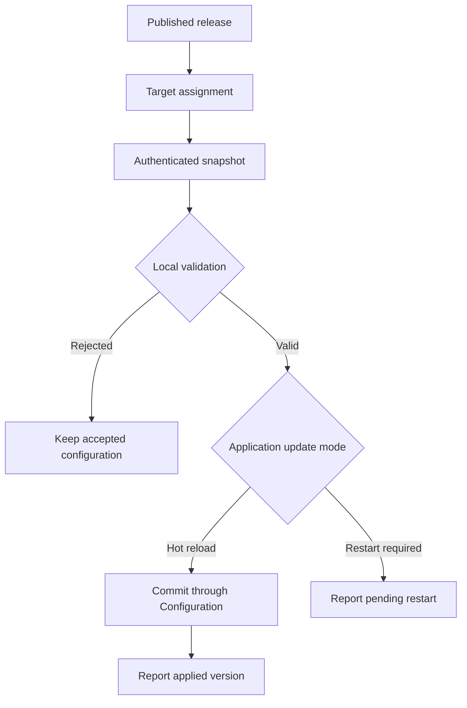

# CISLIB RM-08 Central Configuration Publication and Distribution

**Implementation specification v1.0**  
**Date:** 23 November 2026  
**Status:** Proposed implementation contract  
**Roadmap outcome:** Published configuration reaches the intended applications through the existing Configuration module, with version visibility and controlled updates.

## 1. Purpose and completion outcome

RM-08 adds central publication and distribution to the existing CISLIB Configuration module. Operators publish immutable configuration content, deliberately assign it to application targets, and see which running instances have accepted it. Applications continue consuming their existing configuration objects and change events.

The management service owns publication, assignment and distribution. The application's Configuration module owns source composition, validation, retained objects and local application. RM-07 continues to own authenticated bootstrap and authority to admit managed work.

The module is complete when an operator can publish and assign a configuration, observe its adoption by the intended application instances, identify rejection or pending restart, and restore an earlier configuration through a new controlled assignment. Management or storage outages must preserve an existing process's accepted configuration while the RM-07 admission rules remain effective.

This specification defines new requirements. Existing behavior is identified explicitly and linked in section 20. It does not assert that RM-08 or the outstanding RM-07 requirements are already implemented.

## 2. Dependencies and existing contracts

### 2.1 Preserve the Configuration module

The baseline is CISLIB main commit `494e89412a115078a60ca88b8536337db566665f`. Its Configuration contracts establish the following behavior, which RM-08 must preserve. [S1], [S2], [S3], [S4]

| Existing behavior | RM-08 requirement |
| --- | --- |
| One retained concrete root for each discovered configuration type | Central updates must update that root through Configuration; they must not replace DI registrations or introduce another application configuration model. |
| Captured defaults, then `CommonConfiguration`, then the fixed host application's record | Preserve this exact precedence and its existing merge rules. |
| Fixed `ConfigurationOptions.HostApplicationName` | Do not redirect configuration scope using `EnvironmentOptions.ApplicationName`, a display name, machine name or request parameter. |
| Persisted definition includes full CLR type name and defining assembly identity, excluding assembly version | Preserve existing persisted keys. Add explicit portable identity mappings without renaming existing definitions. |
| Initial load occurs before consumer construction | Central configuration must be available during preparation, before Build and before consuming constructors run. |
| Per-root commit gate shared with `IConfigurationReader` | Preserve the supported consistent-read guarantee. Raw property reads do not become an atomic multi-property snapshot. |
| Effective typed checksum suppresses unchanged updates | Source publication, assignment generation and effective checksum remain separate facts. |
| Initial accepted revision is zero; runtime changes advance a host-local revision | Do not substitute a central version for this revision or change its restart behavior. |
| `ConfigurationChanged` follows an accepted effective runtime change | No event for initial loading, duplicate delivery, failed validation or unchanged effective values. |
| Ordinary failed refresh retains accepted values | A remote failure must never be translated into confirmed source absence. |
| Unexpected throwing live setter disables its entry and may leave partial assignments | Preserve explicit terminal-fault reporting; do not claim that arbitrary throwing setters are rolled back. |

The current store reads common and application records independently. Those reads do not establish a coherent central release. RM-08 must add the small integration seam described in section 9 rather than assume this guarantee already exists. [S2], [S3], [S4]

### 2.2 RM-07 prerequisite

RM-08 depends on the agreed RM-07 v1.1 behavior:

- Existing processes retain the last complete accepted state during loss of management connectivity.
- Work already admitted may settle according to its own execution and ownership rules.
- Failed or expired management authority prevents new managed work.
- New and restarted processes require live authenticated bootstrap and authoritative reconciliation.
- Control freshness is separate from configuration freshness. Preserve the agreed initial 5-second control checks and authority freshness of no more than 15 seconds; a configuration response cannot renew that authority by implication.
- The selected authoritative store supplies the required single-instance or shared-backend consistency, concurrency, durability and recovery guarantees.

The inspected RM-07 branch, commit `38031b41b4d8ce4f7e991b71038abdd60689532c`, still documents optional reporting and `RequireInitialRegistration = false`. Its existing Stage 2 registration path is not the mandatory pre-construction bootstrap required here. Implement and verify the outstanding v1.1 behavior before claiming the combined RM-08 outage or bootstrap acceptance cases. Contract and isolated component work may proceed in parallel. [S5], [S6], [S7]

Other integrations reuse RM-01 identity and authorization, RM-02 original transactions, RM-03 operation-result recovery, RM-06 audit staging, and existing REST, Heartbeat, Healthcheck, Logging and Metrics. They must not create replacement frameworks.

## 3. Initial implementation scope

The first implementation includes immutable source publications; coherent releases containing exact common and application source versions; explicit application and environment assignments; optional trusted deployment cohorts; validation and preview; manual promotion and rollback; conditional distribution; a C# Configuration adapter; per-instance adoption reporting; C# and TypeScript management APIs; and focused real-provider acceptance tests.

The initial update modes are `HotReload` and `RestartRequired`. The application declares the mode for each centrally managed definition. The publisher cannot override it.

The initial implementation excludes a portal, a rule engine, scheduled publication, percentage-based rollout automation, automatic health-based promotion, a multi-person approval engine, fleet-wide simultaneous activation, a transaction spanning multiple configuration roots, a secret vault, and a new broker or WebSocket platform. RM-09 can consume the APIs without changing their meaning. A complete TypeScript or Kotlin Configuration runtime is not part of RM-08.

## 4. State model and version meanings

Use the following distinct concepts. None may be represented solely by an ambiguous field named `version`.

| Concept | Required meaning |
| --- | --- |
| Configuration definition | Stable portable identity, exact schema version, consumer binding and locally declared update mode. |
| Source publication | An immutable common or application source record, including its exact payload and publication identity. |
| Release | An immutable, application-specific pair of source publication references, each explicitly present or absent. |
| Assignment | The current decision selecting a release for an application/environment and optionally a trusted cohort. |
| Assignment generation | A strictly increasing decision sequence within one application/environment/configuration/schema assignment map. |
| Observed desired state | The assignment an instance most recently received from an authenticated authoritative response. |
| Applied state | The release and generation actually accepted by that process's Configuration runtime. |
| Local accepted revision | Existing process-local Configuration revision; zero at initialization, incremented only by effective runtime changes. |

Published content is immutable. Assignments are mutable under optimistic concurrency. Instance reports are observations, not publication authority.

A rollback creates a higher assignment generation referring to an earlier release. It does not decrement a counter, rewrite a publication, or conceal an intervening failed rollout.

A newer generation can contain identical effective values. In that case the instance advances accepted provenance and reports `AppliedUnchanged`, while retaining the same object, local revision and event count.

The normal distribution path has two explicit local outcomes after validation:

## 5. Portable identity and eligible consumers

### 5.1 Definition declaration

Each centrally managed definition must have an explicit descriptor containing:

- `configurationId`: a stable, case-sensitive portable identifier, such as `wallet.compaction`.
- `schemaVersion`: an exact positive version identifying the agreed data shape and defaults contract.
- The .NET persisted definition to which it maps in the C# adapter.
- The fixed host configuration scope and its authorized management application binding.
- `updateMode`: `HotReload` or `RestartRequired`.
- A bounded description of supported structural requirements and the local validation registration.

The descriptor is application/deployment configuration, not an instruction accepted from an arbitrary response. Discovering an `IConfigurationObject` does not automatically expose it for central management. Require explicit enrollment of selected definitions. Existing non-central configurations keep their current behavior.

Mappings must be exact and one-to-one within a host. Reject duplicate portable IDs, ambiguous CLR bindings, incompatible schema declarations and scope mismatches before consumer construction. Do not use short type names, reflective type names supplied by a remote caller, or automatic identity migration.

TypeScript and future Kotlin consumers use `configurationId` and `schemaVersion`; they do not need to manufacture assembly-qualified names. Source revisions for different schema versions remain distinct. Unknown or unsupported schema versions reject the candidate visibly.

For a centrally managed schema, defaults must be deterministic under that declared contract. An incompatible change to mapped shape, defaults or validation requires a new schema version or an explicitly documented compatible evolution. Management does not execute arbitrary consumer constructors or validators to discover these facts.

### 5.2 Initial catalog provisioning

Provision definitions, schema identities, authorized application bindings, source streams and allowed cohort mappings through one operator-controlled management deployment manifest. The service applies it idempotently through its authoritative-store initialization path before advertising usable configuration handlers. A unique logical catalog key allocates stable stored resource IDs and an initial readable ETag, including for an empty source catalog or unassigned map.

Restart or manifest reload must not reset IDs, ETags, generations or assignments. An existing immutable schema identity cannot be silently redefined; incompatible changes require a new schema entry. Changed catalog metadata uses the existing guarded mutation/result/audit conventions. Provisioning failure leaves the affected capability unavailable. Application registration may report supported definitions but cannot create publication authority or silently redefine the authoritative manifest. No separate administrative CRUD framework is required for v1.

### 5.3 Authenticated target resolution

Management resolves application and environment from RM-01/RM-07 trusted identity and server-side mapping. Its opaque `applicationId` identifies the admitted application/environment resource. Body fields may assert expected identity for consistency checks; they cannot select another tenant, environment or application.

The fixed Configuration host scope and the management application identity have different roles. Their binding must be established by trusted deployment configuration. Do not assume that changing a telemetry application name changes the Configuration storage scope. [S1], [S4], [S5]

Every source is environment-specific. A common source is common only within its authorized environment and definition/schema boundary. There is no implicit production-to-test fallback or wildcard cross-environment search.

## 6. Composition and coherent releases

### 6.1 Preserve existing merge semantics

The effective value remains:

1. The Configuration runtime's once-captured defaults.
2. The selected common source.
3. The selected fixed-host application source.

Absent members inherit lower values. Nested objects merge present members. Sequences and dictionaries replace the lower collection as a whole. Empty collections, empty strings, zero and false are values. Explicit null follows the existing nullable contract; it is not a deletion instruction. Unknown properties retain existing structural validation and ignore/diagnostic behavior. Each supplied source is validated before overlay, so an invalid common value still fails when an application value would mask it. [S2]

Removing an application override recomposes from the selected common publication and captured defaults. Removing a source member likewise recomposes from lower layers rather than preserving stale live data.

### 6.2 Release contents

A release must identify one exact application/environment/configuration/schema and contain:

- An immutable `releaseId`.
- The exact common source publication reference, or explicit absence.
- The exact application source publication reference, or explicit absence.
- Publication actor, authoritative creation time, bounded change reason and applicable validation evidence.
- Immutable source integrity metadata.

The release must never contain a floating reference such as `latest`. Its sources must belong to the correct definition/schema/environment; its application source must belong to the intended application binding.

Release creation validates reference existence and retention atomically with installing those references, so concurrent history cleanup cannot remove a source between validation and commit. Validate the complete encoded resolved snapshot, including both escaped payload strings and the maximum supported target/session envelope overhead, against the service's declared distribution limit before allowing assignment. A release that the service cannot distribute must not become an active assignment; tighter individual client limits can still produce a visible client rejection.

An explicit absent source is a first-class, authorized release choice. HTTP failure, timeout, authorization refusal, unexpected NotFound or an unavailable backend are not absent sources. An authenticated release with both sources explicitly absent is the deliberate way to select captured defaults for an enrolled definition.

Example: release R10 pins common C4 and application A7. Publishing C5 creates new content only. R10 still means C4 plus A7. A release R11 can pin C5 plus A7 and later be assigned deliberately. The application must never accidentally apply C5 plus an independently fetched application source from another release.

### 6.3 Common changes and multiple applications

A common publication may be reused by several application-specific releases. Preview must identify affected applications and their override sources. Publishing a new common source does not silently retarget every application.

Applying that common change to several applications creates or selects the corresponding coherent releases and updates their assignments explicitly. Each application's assignment commit has its own result and concurrency boundary. A bulk client must report partial completion honestly; this module does not promise one transaction across an entire fleet.

## 7. Validation, preview and publication

### 7.1 Drafts and validation

The initial draft is caller-owned authoring input. RM-08 need not add a persisted draft workflow. Provide side-effect-free validation and preview APIs that can later support the portal.

The server validates authorization, scope, identities, exact schema support, bounded valid JSON, duplicate decoded keys, source shape and declared structural rules. Preserve the Configuration distinction between closed management command objects and configuration payloads whose unknown properties may be ignored.

Preview identifies the exact source revisions, assignment preconditions, default/cohort targets and currently known compatible registrations. It shows additions, removals and overrides without including unauthorized applications. Values must be redacted where disclosure is not authorized. Preview is informational; mutation must reauthorize and check its preconditions at commit.

Application-specific typed and cross-property validation remains in Configuration. Server validation success means the publication is structurally eligible; it does not prove that every deployed consumer will accept it or has applied it.

### 7.2 Immutable source publication

Publishing stores the exact source content as an immutable revision. Common and application publications have separate authorized source streams. Source absence may be represented by an immutable tombstone or by the release's explicit absence marker; neither path may be confused with a failed read.

Use the established RM-07 command pattern: current resource authorization, an original caller-selected idempotency key, a strong precondition on any mutable source/catalog state, and the original RM-03 recorded-result behavior. A first publication uses the registered source/catalog's existing ETag, not a fabricated token or a wildcard replacement.

The immutable payload, necessary catalog transition, original operation result and required RM-06 audit staging must commit together through the selected authoritative store's original transaction boundary. A newly committed success must not be returned before actual known durable commit. Notifications are emitted only after that commit.

Apply this original-transaction/result/audit rule to every state-changing configuration command, including immutable release creation and guarded catalog changes. Matching release-create replay returns the same original release ID and produces no additional release or audit record.

Matching recovery returns the original result before reevaluating the old precondition. A lost response retains the original key. Neither SDK creates a replacement key or automatically repeats an uncertain publication with new intent. `NotFound` during later lookup does not prove rollback. [S5]

The command fingerprint includes command version, authorized target/source identity, exact schema, immutable payload bytes or source references, complete assignment intent where applicable, change reason and the original precondition. Reusing a key with different intent is a conflict. Keep caller/resource scope derivation identical for execution, replay and result lookup.

### 7.3 Payload integrity

The source publication stores and distributes an exact UTF-8 JSON text and its SHA-256 digest. To avoid cross-language reserialization differences, the v1 snapshot uses a `payloadJson` string containing that exact text; its digest is computed over the decoded string's UTF-8 bytes, not over the outer envelope. Reject malformed Unicode, a BOM, invalid JSON, duplicate decoded object names and excess depth/size. Do not silently normalize or truncate the content on receipt.

Clients verify the digest before mapping. The payload digest establishes content integrity within authenticated distribution; it is not an authentication credential. It is separate from Configuration's existing typed effective checksum, whose format must remain unchanged. Do not require TypeScript to reproduce a .NET-specific effective checksum merely to use management APIs.

## 8. Targeting, staged updates and rollback

### 8.1 Assignment map

For each application/environment/configuration/schema, maintain one authoritative assignment map with a strong ETag and monotonically increasing generation. It contains a default release and zero or more exact named cohort overrides.

Resolution is deterministic: a trusted matching cohort override wins; otherwise use the default. There are no overlapping label expressions, regex selectors, percentages, per-property targeting or multiple matching precedence rules in v1.

Cohort membership must come from trusted RM-07 bootstrap mapping controlled by the operator/deployment. Examples are separately admitted deployment identities mapped to `canary` or `stable`. Arbitrary reported labels, request fields or a locally chosen cohort name cannot select an override. If the deployment cannot securely distinguish cohorts, use the application default.

Membership is fixed for the admitted process session. A deployment membership change takes effect through a new authenticated bootstrap, not an unauthenticated label edit. A new or restarted instance receives its current trusted cohort's assignment. This makes a restart-required canary remain a canary across restart when the deployment identity remains in that cohort.

### 8.2 Manual rollout

The first rollout is deliberately small:

1. Publish source content and create a coherent release.
2. Validate and preview its scope and exact references.
3. Assign the release to a trusted canary cohort, or directly to the application default when no cohort is configured.
4. Inspect current adoption, rejection, pending restart and application health observations.
5. Promote by updating the default assignment under its current ETag.
6. Remove the promoted cohort override in the same assignment-map transaction when it should resume following the default.

Promotion must not leave an unnoticed old override pinning future canary instances. The command states which override is retained or removed, and preview displays that result. Other deliberate cohort overrides remain explicit.

There is no automatic rollout scheduler in v1. Stopping a rollout means making no further assignment expansion. It does not revoke a response already sent, undo an applied update, or stop new members of a still-assigned cohort receiving its release.

### 8.3 Rollback and removal

Rollback selects an existing compatible release and commits a new higher generation under the current ETag. It uses the same audit, authorization, distribution, validation and adoption reporting as any other assignment.

The rollback command explicitly identifies the default and/or cohort entries it changes, or restores a complete earlier map. Rolling back only the default does not change an overriding cohort. A rollback of a particular rollout must cover every assignment entry changed by that rollout, while preserving unrelated deliberate pins; preview and the recorded result show that exact scope.

For `HotReload`, rollback can change live values. For `RestartRequired`, rollback may itself require restart; the service must not claim instantaneous recovery. If the rollback release already matches the running effective values, provenance can reconcile without a needless restart or event after successful validation.

Removing a cohort override deliberately returns that cohort to the current default under a new generation. Removing an application source is a new release with that source explicitly absent. Removing the only assignment for an enrolled definition is not a hidden reset-to-default command: reject it while required consumers remain, or first assign an explicit defaults release.

## 9. Distribution through the existing Configuration module

### 9.1 Authoritative snapshot reads

Provide an authenticated conditional read for one enrolled definition and current registration. It returns one complete resolved snapshot containing identity, registration/cohort binding, release, generation, both source states and their exact payloads/digests. The service obtains assignment and references from one coherent authoritative observation.

Use opaque ETags for equality only. A not-modified response is valid only with the exact previously retained snapshot for that target, schema and session. It must not create missing state or refresh RM-07 admission authority. The service must not return not-modified from a disconnected replica cache when it cannot establish authoritative state.

The client must reject a generation lower than the highest authenticated generation it has already observed for that assignment map. Equal generation with conflicting content is an integrity failure. Never compare ETags or UUIDs as ordered values. Validate target and session again immediately before local commit, including when a newer response has superseded an in-flight candidate.

The guarantee is convergence to current desired state, not instantaneous fleet activation. An assignment can change just after a valid fetch; the next reconciliation resolves that change. Reconnection may skip obsolete intermediate releases and fetch the current assignment directly.

### 9.2 Coherent source integration

Introduce an additive paired-snapshot capability alongside `IConfigurationStore`, for example `IConfigurationSnapshotStore`. It returns the common and application source observations plus one opaque provenance stamp for the same reconciliation. The coordinator uses this capability when supplied and preserves the existing independent-read path for older stores.

This capability is mandatory for centrally managed definitions. Reject selection of a central adapter that cannot provide it. The compatibility fallback to independent source reads is available only to existing non-central stores.

The exact implementation may use a small equivalent read-cycle abstraction, but it must provide one pinned release throughout preparation and commit. Replacing two cache entries at different times is insufficient. Do not depend on assumed timing between consecutive `ReadAsync` calls.

Provenance must travel with the candidate through actual acceptance. Add the smallest internal coordinator hook needed to distinguish rejected, staged, applied and valid-unchanged results. Inferring acceptance from successful HTTP, a watcher notification, `ConfigurationChanged` alone, or an unrelated later status capture is prohibited.

The C# management adapter must map explicit present/absent source states to the existing source semantics. Errors remain failures. Existing providers and public method signatures must remain usable without implementing new mandatory members. Do not replace the existing mapper, reader gate or event owner.

### 9.3 Polling and optional notification

Conditional polling is the required convergence path. Reuse the existing Heartbeat integration, per-entry serialized work and coalesced invalidation behavior. The host explicitly selects a positive Configuration polling interval; 30 seconds is a documented example, not a new default for the base Configuration module.

A polling-only central adapter declares `ConfigurationNotificationMode.None`. If an existing transport later supplies change hints, use `RequiresReconciliation` and keep periodic reconciliation. Notification callbacks request a reread; they do not apply attached values or grant authority.

Missed, repeated and reordered hints must converge without an event backlog. Reconnection invalidates relevant snapshots and triggers current-state reconciliation. Do not add another timer, retry owner, broker requirement or per-version replay queue. Configuration polling and the shorter RM-07 control-freshness checks remain independent.

## 10. Local validation, activation and event behavior

### 10.1 Acceptance pipeline

For every candidate, the application must:

1. Verify its authenticated target/session binding, supported schema, generation, size and integrity.
2. Pin the complete common/application source pair.
3. Use the existing detached composition and validation pipeline.
4. Evaluate the application's declared update mode.
5. Commit or stage through the Configuration owner.
6. Associate accepted provenance with the actual local result and expose an adoption observation.
7. Preserve the existing post-commit event behavior and separate subscriber diagnostics.

Do not run consumer validators on the service by loading consumer assemblies. Do not bypass a local rejection because the server accepted the publication. A rejected candidate keeps the prior accepted root, revision and applied provenance, and identifies the rejected desired release separately.

Commit immutable accepted provenance under the same entry gate as accepted values/checksum/revision, including a valid-unchanged acceptance. Cancellation, stopping or subscriber failure after acceptance must not discard that provenance. Status must not combine values from one release with an applied label from another. Copy the resulting observation after the gate; do not call arbitrary observers or perform network reporting inside it.

### 10.2 Hot reload

`HotReload` uses the existing per-root commit gate. Consumers needing consistent values copy them through `IConfigurationReader`; a long-running operation may retain that copy for its own duration. Configuration does not retroactively alter values already captured by admitted work.

Effective changes advance the local revision and publish the existing event after releasing the value gate. Valid unchanged values advance central acceptance metadata only. An initial load establishes revision zero and emits no reload event.

A synchronous subscriber failure cannot undo the accepted value, change `Applied` into `Rejected`, or prevent later subscribers under the existing event rules. Report a separate notification warning. Acceptance of the POCO values is not proof that every application-specific side effect has finished. [S1], [S2], [S3]

### 10.3 Restart required

For `RestartRequired`, validate a runtime candidate through the same preparation pipeline, retain it within the bounded candidate state, report `PendingRestart`, and leave live values and applied provenance unchanged. No change event is emitted.

On the next process start, live bootstrap resolves the then-current assignment and Configuration applies it as the initial baseline before consumers are constructed. Do not blindly install a previously staged local candidate. A newer assignment supersedes that candidate; a rollback can remove the need for restart when it validates to the currently active effective values.

The publisher cannot turn `RestartRequired` into `HotReload`. The initial implementation supplies no remote restart command and no arbitrary consumer-defined asynchronous activation workflow.

### 10.4 Fault boundaries and atomicity

Normal fetch, schema, integrity, mapping and validation failures occur before commit and preserve the previous accepted state. A broken live setter is different: existing Configuration can disable the entry after partial writes. Surface `Faulted`, retain the last accepted provenance as historical rather than claiming it describes intact live values, and expose the actual health failure. Do not retry that entry indefinitely or advertise last-known-good safety after this contract violation. [S2]

Atomicity is per root and applies to consumers using the supported reader. There is no transaction across several configuration objects or across processes. Put tightly coupled invariants in one configuration object. Do not implement a distributed commit protocol to expand this guarantee.

## 11. Bootstrap, outage and recovery

### 11.1 Bootstrap sequence

Every centrally enrolled definition requires a live, authorized, complete and valid release before the new process becomes ready. A valid empty release can authorize defaults; an absent assignment or failed fetch cannot.

The supported sequence is:

1. Establish local bootstrap identity, environment, endpoint discovery, trust and credential access.
2. Prepare Type Manager and the declared configuration bindings.
3. Perform the RM-07 live authenticated bootstrap needed to establish this process/session and its trusted target/cohort.
4. Fetch and validate each required central release; populate the existing Configuration roots before consumer construction.
5. Build the ordinary single application provider and construct consumers using those initialized roots.
6. Activate Configuration observation and reconcile the preparation-to-activation gap through the existing sequential Startup integration.
7. Complete RM-07 admission reconciliation and remaining startup requirements, then permit readiness and managed-work admission.

The RM-07 bootstrap receipt alone does not make the application ready or permit business work before the subsequent stages complete.

Endpoint, identity/environment, trust roots, bootstrap credentials and the management service's own authoritative-store connection must be independently available. They cannot depend solely on the central configuration being fetched. Do not make the management service call its own unavailable configuration API to start.

The existing `IManagementClient` borrows a DI-registered keyed REST client, while Configuration preparation precedes consumer construction. Add a bootstrap-capable composition path that reuses the existing transport/authentication implementation and explicitly owns its resources before Build. Do not create a temporary service provider, bypass RM-01, create an unauthenticated fallback client, or block waiting for Stage 2 or the first Heartbeat tick. Transfer or share ownership deliberately with the normal host, with exactly one actual cleanup barrier. [S4], [S6]

### 11.2 Outage behavior

| Situation | Required result |
| --- | --- |
| Running process loses management connectivity | Retain its accepted configuration and expose connectivity/freshness separately. RM-07 closes new managed-work admission when authority fails or expires. |
| Already admitted work is running | Preserve its captured configuration and existing work/lease rules. RM-08 grants no new lease or permission to continue work whose own authority is lost. |
| New or restarted process cannot complete live bootstrap | Remain not ready; no managed work. A disk cache does not bypass this requirement. |
| Referenced publication cannot be read | Reject the candidate fetch; preserve accepted state. Do not substitute defaults or another source version. |
| Candidate fails local validation | Keep accepted values, report the rejected desired release, and await a later legitimate reconciliation or correction. |
| Backend is unavailable but a management replica is alive | The replica cannot publish or assert authoritative unchanged/current state from its local cache. |
| Connectivity returns | Reauthenticate as required, reconcile current authoritative desired state, apply or stage it, report current adoption, and let RM-07 decide when admission can reopen. |
| Credential or authorization refusal occurs | Preserve data already accepted in memory, expose the refusal, and obey RM-07/security admission rules. Do not keep fetching through weaker credentials. |

There is no default configuration TTL that clears accepted values. Configuration age is an observation. Any business rule that requires a maximum age must be explicit and enforced by its owning application policy; it must not be confused with RM-07's authority lifetime.

RM-08 does not guarantee instantaneous revocation of already delivered values while an application is disconnected. Security decisions that require current authority remain with RM-01/RM-07 and the relevant resource owner.

### 11.3 Local retained state

For an already running process, in-memory accepted state is sufficient for the required outage behavior. A persistent client cache is optional and is not required for v1. If supplied, it must preserve complete versioned snapshots, scope/session provenance and integrity and remain bounded. It is recovery material, not startup authority.

Retain the last accepted provenance and at most one current candidate or rejected/pending snapshot per definition, with transient fetch buffers covered by the aggregate budget. Coalesce newer desired state. Do not retain every missed publication, polling response or failure.

An obsolete response from an earlier session cannot overwrite current state. Server recovery must not reuse an assignment generation for different content. An unsafe backend restore must follow RM-07 recovery/fencing rules and withhold authoritative service until its incarnation and ordering guarantees are restored; clients must not silently reset their comparison state to accept a regressed store.

## 12. Authoritative persistence and management replicas

Extend the selected RM-07 authoritative store; do not create a second independent configuration authority. The persistence contract covers source publications, release references, assignment maps, original operation results, required audit staging, and current adoption observations.

Standalone and shared operation must expose truthful capabilities. A durable standalone RM-07 store can serve one management instance when it supplies the required semantics. Shared operation uses the selected RM-07 backend and permits several management replicas to serve the same committed state. An in-memory development mode cannot advertise durable publication or restart recovery.

Use PostgreSQL as the initial shared reference integration, consistent with the RM-07 direction. Redis and Cosmos DB remain possible adapters under the same capability contract; this specification does not require implementing all three in RM-08. A backend is supported only when its concrete implementation proves the required atomicity, durability, concurrency and recovery behavior. A distributed lock or eventually copied process cache is not a substitute.

Required storage guarantees are:

- A committed release references durable immutable sources in the correct scope. No assignment may become visible before all referenced data is readable.
- One assignment-map mutation atomically changes its default/cohort entries, ETag and generation.
- Publication/assignment state, original operation result and mandatory audit staging share the original atomic commit boundary. Provider-specific implementations must expose equivalent semantics rather than silently weakening the guarantee.
- Two writers using the same current precondition cannot both replace the same map successfully.
- Matching idempotent replay returns the original recorded result and does not repeat the effect or audit record.
- After successful commit, another authoritative replica can observe the committed assignment and all its references. A stale replica must not present older data as the current authoritative answer.
- Adoption writes have separate observation sequencing and must not invalidate an operator's publication or assignment ETag.

Distribution is recovered by polling durable current state. Losing a post-commit notification must not lose the update. No additional broker is required.

## 13. Version visibility and adoption reporting

### 13.1 Per-instance observation

Expose a bounded management-owned status projection for every enrolled definition containing:

- Authenticated `applicationId`, current `registrationId`, environment and trusted cohort binding.
- `configurationId`, exact `schemaVersion`, and application/service version from registration.
- The latest observed desired release and assignment generation.
- The last successfully applied release/generation and local accepted revision.
- Current status and any separate candidate-validation or notification failure code.
- Actual observation time and authoritative server receipt time, kept distinct.

Do not put source payloads, credentials, arbitrary exception messages, source equality tokens or configuration values into ordinary status. The existing effective checksum remains an internal value-comparison mechanism; it need not be published. An authorized future diagnostic view may expose a separately designed value fingerprint, but v1 must not infer identical effective values across different consumer builds merely from matching release IDs.

Use these recognized adoption states:

| State | Meaning |
| --- | --- |
| `Pending` | The server has a desired assignment without a current matching acceptance observation. |
| `Applied` | This process actually accepted the desired release with an effective change, or as its initial baseline. |
| `AppliedUnchanged` | This process validated and accepted the desired provenance; effective values did not change. |
| `Rejected` | A particular authenticated assignment/release was identified, but its referenced content or candidate validation failed. Previously accepted values remain valid under the ordinary failure contract. Include a bounded reason distinguishing content fetch, integrity, schema and validation failure. |
| `PendingRestart` | The desired candidate is valid but its effective changes require restart; active and desired versions differ. |
| `Faulted` | The Configuration entry is disabled or its live-state guarantee has failed. Last-successful provenance is historical, not proof of intact active values. |

Connectivity and staleness are separate facets, not substitutions for these states. Unsupported future states remain explicit unknowns and are never interpreted as success.

A failed poll or malformed response received before a trustworthy desired snapshot is available does not establish a new rejected release. Retain the last known desired/applied facts and record a separate last-attempt/connectivity diagnostic. The service may know a newer desired assignment and show its adoption as pending; it must not relabel the old successfully applied release as rejected merely because a connection failed.

### 13.2 Observation sequencing and freshness

Reuse the existing management reporting owner and lifecycle. Configuration observations use a separately sequenced complete snapshot or an existing compatible complete-report stream with the same protections. A higher sequence replaces earlier observations; an equal identical replay does not refresh receipt time; an equal conflicting or lower sequence is rejected. Bind the stream to the current registration incarnation under RM-07's actual authenticated ownership checks. Reports cannot create registrations or update resources outside that ownership boundary. [S5], [S7]

A registration UUID is not a credential or proof of a distinct physical process. Replicas sharing a workload identity share that identity's trust boundary. Preserve RM-07's reported-versus-verified instance evidence; require stronger process-session proof only when the selected RM-07 contract actually supplies it. Do not invent such proof from a body label, sequence or UUID.

Retain only a bounded latest/pending snapshot, with the existing uncertainty handling after an attempted report loses its response. Periodic current captures may use a new sequence to provide fresh observations. Retries of the same capture retain its original sequence, content and time. Do not create a separate timer or an audit event for each unchanged poll.

The service computes adoption against the assignment currently resolved for each target. A historically `Applied` report for an older release does not prove current convergence. Show stale or offline registrations separately from fresh accepted, pending, rejected and pending-restart registrations. Report no-instance cohorts as having no observed recipients, not as successfully adopted.

An adoption acknowledgement confirms local acceptance only. It does not prove every business operation has switched its previously captured values, that every subscriber completed external effects, or that all application instances share an identical instantaneous state.

## 14. HTTP contract and SDK requirements

### 14.1 API surface

Add typed configuration operations under the existing `/management/v1` base, preserving any configured URL prefix. The following route families define the required surface; final schemas must fix their exact request/response shapes before implementation and keep one canonical OpenAPI source.

| Operation | Route family and behavior |
| --- | --- |
| Discover configuration definitions | `GET /configuration/definitions`; authorized descriptors and capabilities. |
| Validate and preview | `POST /configuration/validate` and `POST /configuration/preview`; side-effect-free, scoped, bounded inputs and explicit source/target references. |
| Read source catalog | `GET /configuration/sources/{sourceId}`; authorized source metadata, its current ETag and paged publication history. |
| Publish source revision | `POST /configuration/sources/{sourceId}/publications`; immutable content, original idempotency key and required catalog precondition. |
| Read publication | `GET /configuration/publications/{publicationId}`; reauthorize its actual scope. Knowing an ID grants no access. |
| Create/read release | `POST /applications/{applicationId}/configuration/{configurationId}/releases` and `GET /configuration/releases/{releaseId}`; exact schema and source references. |
| Read/replace assignments | `GET` and `PUT /applications/{applicationId}/configuration/{configurationId}/assignments`; exact schema selection, complete bounded map, strong ETag and original operation key for mutation. |
| Resolve runtime snapshot | `GET /registrations/{registrationId}/configuration/{configurationId}`; current authenticated target, exact enrolled schema and conditional ETag. |
| Report adoption | `PUT /registrations/{registrationId}/configuration-status`; complete bounded sequenced observation. |
| Inspect adoption | `GET /applications/{applicationId}/configuration-status`; authorized current desired state plus last reported instance facts and freshness. |
| Recover mutation result | Typed recovery using the existing RM-07/RM-03 original operation-reference pattern; retain operation name, derived actor/resource scope and original key. |

An initialized but unassigned map can have an ETag without an assignment generation. The first valid assignment allocates a positive generation. Thereafter every map mutation advances it; exhaustion rejects further mutation rather than wrapping or reusing a number.

Immutable release creation is idempotent under its original key. Apply strong preconditions to any mutable catalog/head changed by that command. A successful create does not activate the release. Promotion and rollback are explicit assignment-map commands; clients must not simulate them through several unguarded writes.

### 14.2 Portable encoding

Preserve RM-07's conventions: canonical positive Int64 decimal strings for assignment and observation sequences, exact UTC timestamp text, opaque strong ETags, strict closed command objects, additive response compatibility, explicit unknown status handling, safe Problem Details, original operation results and exact resource authorization. The local Configuration revision also permits `"0"`. Never route a large revision through a JavaScript number. [S5]

For new fields, `configurationId` and `cohortId` use 1–128 URI-unreserved ASCII characters with exact comparison, excluding the complete values `.` and `..`. Publication, release and source-resource IDs use canonical lowercase UUID text. `schemaVersion` is a canonical positive Int64 decimal string. A command's change reason is nonempty valid Unicode bounded to 1,024 UTF-8 bytes. Keep all limits in the portable schema and enforce them before routing or materialization.

Publications preserve exact `payloadJson` content separately from typed data parsing. Do not add platform type names, serialized delegates, arbitrary CLR converters, executable expressions or framework exceptions to the wire contract.

Requests, responses and status snapshots are complete bounded values. Do not truncate a source, target list or status snapshot and call it successful. Paged history and status queries use existing authenticated cursor rules.

### 14.3 C# and TypeScript clients

Expose a typed, substitutable configuration port, such as `IManagementConfigurationClient`, using the existing transport, authentication, cancellation, deadline, error and operation-recovery behavior. Keep `IManagementClient` and current implementations compatible; do not add compulsory abstract members to existing public ports merely to append RM-08.

The C# Configuration store adapter is separate from administrative editing calls. Application code should enroll its definitions and select the central store once; it should not implement per-POCO HTTP, polling, validation or acknowledgement loops.

Extend the existing portable TypeScript management package with the same definition, validation, publication, release, assignment, status and recovery operations. Preserve lossless revision/timestamp handling, per-call credentials and independence from React, Next.js and Node-only imports. Server-only credential integrations remain explicitly server-only. A full TypeScript POCO mapper or Kotlin implementation is deferred; the protocol and conformance fixtures must be sufficient for a future implementation. [S5], [S6]

Read retries use existing explicitly selected policies. Publication and assignment SDK methods do not automatically invent keys or retry uncertain effects. Cancellation requests actual transport cancellation and joins owned cleanup; it does not prove that a remote mutation rolled back.

## 15. Authorization, audit and sensitive data

Define resource-scoped capabilities for definition/catalog read, source-content read, validate/preview, publish, release creation, assignment mutation/rollback, adoption read, and self reporting. Reuse RM-01's native resource and actor model instead of introducing another role database.

Every execution, replay, lookup and content fetch is freshly authorized against its actual resource. An application's registration permits only its admitted runtime view and self-reporting; it does not grant publication or cross-application access. A common publication's read path must not reveal private application overrides.

A common-source publisher does not automatically acquire permission to retarget every consuming application. Each assignment requires the corresponding application/environment authority. Human/delegated operator identity remains distinct from a portal workload identity; preserve actor-specific original-result recovery.

Publication and assignment changes stage the required RM-06 administrative audit in the original mutation transaction. Record actor, resource, action, original operation reference, before/after revision or assignment identifiers, and a bounded reason. Required audit-staging failure prevents commit. Do not introduce an audit destination database, collector or retention scheme under RM-08.

Configuration payloads must not be copied into routine logs, metrics, health details or audit records. Use secret references only where an independently implemented secret integration supports them. Raw private keys, access tokens and bootstrap passwords are outside ordinary configuration publication. RM-08 does not add a secret resolver or promise to erase values already delivered to a disconnected consumer.

TLS, endpoint validation, credential providers and redirect rules remain those of RM-01/RM-07. Configuration content cannot change the sole bootstrap endpoint, trust or credentials needed to retrieve itself during the same activation.

## 16. Observability, bounds and lifecycle

### 16.1 Health and metrics

Expose current connectivity, last successful authoritative reconciliation, candidate outcome, active/desired release relationship, pending restart and terminal fault through bounded status and existing Healthcheck integration. Hosts continue to choose Configuration health criticality explicitly. Do not silently change the base module's defaults or infer invalid live data merely from an old successful configuration.

RM-07's authority gate decides managed-work admission. A terminal Configuration fault must be visible to the actual host/application health policy. An application may deliberately require additional freshness; that policy must be explicit and must not be disguised as an ordinary polling failure.

Reuse existing REST and Configuration instrumentation. Add only the bounded module observations needed for publication, assignment and adoption outcomes. Preserve mandatory application/environment dimensions. Do not use instance IDs, registration IDs, release IDs, configuration values, exception text or unbounded configuration names as metric labels, and do not add a second timer around operations already measured by their owner.

Routine successful polling produces no normal-level log stream. Repeated failure/recovery diagnostics use the existing monotonic rate/budget conventions and remain safe even with a 10 ms selected Heartbeat interval. Suppressing a diagnostic must never suppress a request, validation result, health observation or original fault.

### 16.2 Initial finite limits

The following are proposed v1 reference defaults. Make them explicit in options and wire documentation; reject unsupported selections and preserve tighter caller/server limits.

| Limit | Reference default |
| --- | --- |
| One source's decoded UTF-8 JSON | 256 KiB |
| One configuration command or resolved snapshot, including encoded envelope | 1 MiB |
| Maximum JSON depth | 16, consistent with the ordinary management profile |
| Centrally enrolled definitions per application | 256 |
| Named cohort overrides per assignment map | 16 |
| Retained source/candidate bytes per application process, including owned in-flight fetch buffers | 16 MiB |
| Retained desired candidate per definition | One, in addition to the accepted state/provenance |
| Unreferenced historical releases retained per application/environment/definition/schema | Latest 10 by default, subject to the explicit storage policy |

The 1 MiB configuration request allowance is a specific bounded API profile; it must not silently raise the existing 64 KiB ordinary management-request default for other operations. Existing transport/schema ceilings still apply. Escaped `payloadJson` overhead counts toward the complete envelope limit. [S5]

Local configuration source retention is not a promise to cap the entire CLR object graph or host memory. Apply a separate validated shape/cardinality budget where typed materialization can expand a compact source. Account for candidate and transient buffers before admission; exceeding the configured budget rejects the new candidate and preserves accepted values.

Server deployment sets an explicit total retained-byte quota and history policy. Never garbage-collect content referenced by current assignments or an explicitly pinned rollback release. If pinned data exhausts capacity, reject new publication with a visible capacity result; do not evict active data. Shared common publications are reclaimed only after all retained release references are gone.

Operation-result/idempotency retention follows RM-03 independently of payload-history cleanup, and registration telemetry cleanup follows RM-07 independently of both. A replay of an older publication command may return its original identity after the unreferenced content was legitimately pruned; it must not recreate the publication as a new effect or claim its payload is still available. A rollback to pruned content is rejected explicitly.

### 16.3 Startup and shutdown ownership

No configuration call may run from a constructor or DI resolution. Preparation owns its admitted network work explicitly. A failure before Build must dispose and drain those resources through the same retained ownership path used after successful host composition.

At stopping, close new fetch, trigger and apply admission; cancel owned work; detach acquired observation handles; and join actual bootstrap/reconciliation, accepted notifications, transport bodies and callbacks before disposing dependencies. Preserve existing Configuration/REST/Heartbeat/Startup ordering. A canceled wait is not proof of settlement. There is no mandatory final network acknowledgement required to stop locally.

## 17. Acceptance criteria

Use the existing native test framework, bounded CommonTesting substitutes and real-provider Testcontainers infrastructure. Each case proves an outcome or invariant, not an implementation detail. Several assertions may share a focused fixture; this is not a request for a new large harness. [S8]

| ID | Scenario and required observation |
| --- | --- |
| AC-01 | Existing non-central/defaults-only and custom `IConfigurationStore` consumers retain their public contracts, object identity, initialization, merge and event behavior. |
| AC-02 | A centrally managed value is available in a real consuming constructor before Build/startup completion, using one application provider and authenticated bootstrap resources. Failed preparation/Build joins cleanup. |
| AC-03 | A fresh or restarted managed process with no live authoritative bootstrap remains not ready even when a valid cached or formerly pending release exists. An explicit live empty release can authorize captured defaults. |
| AC-04 | Publish without assignment leaves running applications unchanged. Successful publication, assignment commit, fetch and application are represented separately. |
| AC-05 | Defaults/common/application precedence, nested merge, collection replacement, explicit null, masked invalid common values and override removal match the existing Configuration contract. |
| AC-06 | Concurrent common/application publications cannot produce a mixed release. Central reads require the paired-snapshot capability; independent-read fallback is refused on that path. Missing referenced content fails without becoming source absence. |
| AC-07 | Application/environment/schema/registration mismatches and unauthorized source or status reads are refused without leaking another application's override. Self-reported cohort labels do not redirect targeting. |
| AC-08 | Default/cohort resolution is deterministic. New and restarted processes receive the assignment for their trusted cohort. Cohort membership changes require new bootstrap; old-session responses cannot cross into the new context. |
| AC-09 | Canary promotion updates the default and explicitly participating overrides atomically. A later default change reaches a cohort whose promotion override was removed; deliberate unrelated pins remain intact. |
| AC-10 | Duplicate delivery, unchanged effective values and higher map generation with the same resolved release update provenance without a false local revision or event. Initial baseline remains revision zero. |
| AC-11 | Late lower generations and equal-generation conflicting content cannot overwrite a newer observation or accepted state. A canceled/superseded candidate cannot commit under the wrong session. |
| AC-12 | Invalid schema, JSON, digest, typed value, cross-property condition or size limit rejects the candidate while preserving the valid previously accepted object and provenance. Repeated failures remain bounded. |
| AC-13 | Hot reload retains the root; concurrent supported readers see complete accepted root states. Subscribers run under existing order/isolation rules; a throwing subscriber does not undo application or prevent later handlers. |
| AC-14 | Restart-required updates keep active values unchanged and report both active and desired versions. A newer assignment supersedes the pending candidate. Desired values returning to active values clear pending restart without a false event. |
| AC-15 | A restart fetches and applies the current live desired release, not a stale staged release. A restart-required rollback to different values remains pending restart until that actual restart. |
| AC-16 | A throwing live setter produces disabled/Faulted state, no false candidate acceptance and no claim that the last successful release still describes intact live values. |
| AC-17 | Management and authoritative-backend outages preserve existing accepted configuration. RM-07 independently closes new managed-work admission; admitted work follows its own rules. No replica cache, configuration poll or disk cache renews authority. |
| AC-18 | Reconnect converges after missed/duplicate notifications and several skipped releases using authoritative current state. Required polling recovers an update whose notification was lost. |
| AC-19 | Rollback allocates a higher generation and restores the explicitly selected default/cohort entries without changing unrelated pins. Conflicting concurrent assignment edits produce one winner and a defined conflict. |
| AC-20 | A lost source-publication, release-create or assignment response recovers the original committed result with the original key; effect and required audit are not repeated. Required audit staging failure prevents commit. Unknown completion is not rewritten as rollback. |
| AC-21 | Two real management replicas sharing PostgreSQL observe one committed assignment and its complete references. Writer races, process restart and backend outage preserve ordering, idempotency and atomic visibility. |
| AC-22 | Adoption reports preserve actual registration/workload ownership, independent sequencing and receipt freshness without inventing process proof. Old/equal-conflicting reports cannot fabricate convergence. An unidentified failed poll preserves prior adoption facts. Offline, stale, unknown, no-instance, rejected and pending-restart targets remain visible. |
| AC-23 | C# and TypeScript round-trip exact revisions above 2^53, local revision zero, timestamps, optional response additions, explicit unknown statuses, non-ASCII payload text and exact payload digests. |
| AC-24 | Resource limits, combined encoded release distributability, pinned-history cleanup, source-reference retention, diagnostic budgets and actual shutdown drainage hold under the existing focused tools. Trusted manifest provisioning is idempotent and does not reset existing catalogs/assignments. Feature discovery does not advertise durable publication on an incapable store. |

Use real PostgreSQL tests for original-transaction atomicity, cross-replica visibility, restart persistence and compare-and-set races. Controlled clients prove local state and ownership boundaries; they do not prove database guarantees. Required external-service tests fail clearly when their selected infrastructure is unavailable; fast tests explicitly exclude them. Preserve existing test packaging and keep Docker dependencies out of runtime packages.

Run affected tests and the meaningful public-consumer/compatibility checks. Keep a concise acceptance mapping and result checkpoint. Do not create a new orchestration harness, duplicate test framework, mutation campaign or large evidence archive for this module.

## 18. Implementation sections and parallel work

Use medium-or-smaller implementation stories, each with its own acceptance and tests included. Import this technical specification through the existing CIS route when implementation is requested. This specification task does not authorize repository mutation or execution of an implementation plan.

| Section | Deliverable | Dependencies and parallelism |
| --- | --- | --- |
| A. Portable contract and enrollment | Definition/source/release/assignment/adoption schemas; OpenAPI; trusted identity and version semantics; compatibility fixtures | Start first. Confirm RM-07 v1.1 prerequisite contracts alongside it. |
| B. Durable publication and assignments | Immutable content, coherent releases, atomic assignment map, preview, original-result recovery and required audit staging | After A; may run alongside C. Reuse the RM-07 store/provider boundary. |
| C. C# bootstrap and Configuration integration | Authenticated pre-Build acquisition, required paired snapshots, exact provenance, hot/restart modes and lifecycle ownership | After A; integrate with RM-07 v1.1 and preserve existing Configuration behavior. |
| D. Visibility and SDKs | Adoption projection/reporting, C# typed administration, TypeScript parity and CommonTesting helpers | After A; portions can run alongside B/C, then join real implementations. |
| E. Composed acceptance and consumer example | Focused real-provider/two-replica cases, startup/outage/rollback cases, updated CountryData opt-in recipe and concise completion record | Integrate B–D and the actual RM-07 prerequisite; do not substitute scripted proofs for the native cases. |

Documentation, focused validation, independent review and fixes belong to these implementation stories rather than separate approval chains. Use the existing CIS ownership and acceptance process without duplicating permission steps or reopening completed historical work.

Keep implementation in the current project/module structure. Preserve Core's dependency policy: no new third-party runtime dependencies in Core; optional adapters and the hosted application follow the repository's current approved package policy. Do not reintroduce the obsolete blanket no-NuGet restriction. [S8]

## 19. Deliverables and definition of done

Deliver the versioned portable contract and canonical OpenAPI extension; C# service handlers and Configuration integration; C# and TypeScript typed clients; the selected authoritative-store integration; bounded status and test helpers; and the focused acceptance evidence.

Update the existing Configuration and management consumer guides with bootstrap ordering, source precedence, trusted targeting, update modes, outage behavior, rollback and status interpretation. Extend the one maintained CountryData tutorial through an explicit opt-in example; preserve its database-free/default behavior. Include a concrete example with one common source, one application override, a staged assignment, rejection, restart-required change and rollback as small documented scenarios rather than another application framework. [S8]

Update the relevant repository agent/skill guidance to teach actual enrollment APIs, publication/result recovery, supported readers, version distinctions and failure semantics. Reuse current skills where the subject already belongs; do not add duplicate general guidance. Examples must compile against the implemented public APIs; proposed names in this specification are not evidence that those APIs already exist.

Completion requires every acceptance criterion to have a named implemented behavior and appropriate passing observation, or a clearly declared unmet dependency that prevents closing the affected outcome. In particular, do not close combined outage/bootstrap acceptance while the RM-07 v1.1 admission changes remain outstanding.

The completed behavior must let an operator answer: what is published, what each target should use, what each live instance has accepted, which instances are stale/rejected/pending restart, and exactly what a new assignment or rollback will change.

## 20. Source baseline

These primary repository sources establish existing behavior. Requirements introduced above are RM-08 design decisions, not claims that the sources already implement them.

- [S1] Configuration retained objects, identity, read and event ownership, main `494e8941`.
- [S2] Configuration merge, validation, checksum and commit boundaries, main `494e8941`.
- [S3] Configuration refresh, failure, polling and lifetime behavior, main `494e8941`.
- [S4] Configuration preparation/hosting and the existing store contract, main `494e8941`. The linked hosting guide describes preparation; the [store interface](https://github.com/andrewspiteri/CISLIB/blob/494e89412a115078a60ca88b8536337db566665f/implementations/csharp/src/CIS.Core/Configuration/Contracts/ConfigurationStore.cs) shows the independent record reads.
- [S5] Portable RM-07 management v1 protocol, branch commit `38031b41`.
- [S6] Current C# management client integration, branch commit `38031b41`.
- [S7] Current optional management registration and inventory, branch commit `38031b41`.
- [S8] Repository dependency, integration-testing, consumer-example and practical-work guidance, main `494e8941`.

The RM-07 v1.1 outage, bootstrap and optional shared-backend requirements are carried forward from the agreed project discussion of 23 November 2026. They take precedence over the earlier optional-registration behavior when central management is required for application operation.

[S1]: https://github.com/andrewspiteri/CISLIB/blob/494e89412a115078a60ca88b8536337db566665f/docs/modules/configuration/core.md
[S2]: https://github.com/andrewspiteri/CISLIB/blob/494e89412a115078a60ca88b8536337db566665f/docs/modules/configuration/mapping.md
[S3]: https://github.com/andrewspiteri/CISLIB/blob/494e89412a115078a60ca88b8536337db566665f/docs/modules/configuration/refresh.md
[S4]: https://github.com/andrewspiteri/CISLIB/blob/494e89412a115078a60ca88b8536337db566665f/docs/modules/configuration/hosting.md
[S5]: https://github.com/andrewspiteri/CISLIB/blob/38031b41b4d8ce4f7e991b71038abdd60689532c/contracts/management/v1/README.md
[S6]: https://github.com/andrewspiteri/CISLIB/blob/38031b41b4d8ce4f7e991b71038abdd60689532c/docs/modules/management/csharp-client.md
[S7]: https://github.com/andrewspiteri/CISLIB/blob/38031b41b4d8ce4f7e991b71038abdd60689532c/docs/modules/management/registration.md
[S8]: https://github.com/andrewspiteri/CISLIB/blob/494e89412a115078a60ca88b8536337db566665f/AGENTS.md

